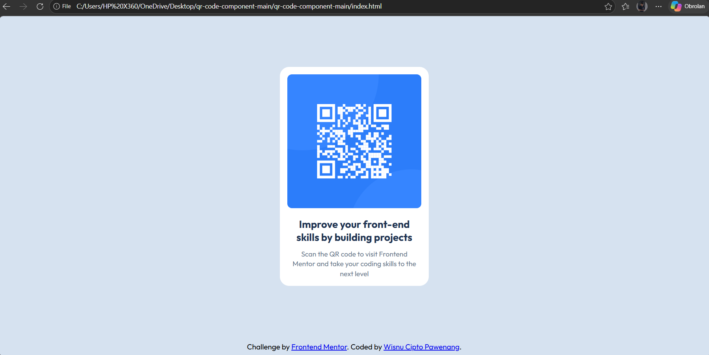

# QR Code Component

A responsive QR code component built with HTML and CSS as part of a Frontend Mentor challenge.

## Overview

This project is a simple QR code component designed to help users improve their front-end development skills through practical HTML and CSS implementation.

The goal was to recreate the provided design as closely as possible while maintaining a clean HTML structure and responsive layout.

## Screenshot

## Links

- **Live Site:** https://wisnu130498.github.io/-qr-code-component/
- **GitHub Repository:** https://github.com/Wisnu130498/-qr-code-component

## My Process

I started by studying the design reference and style guide provided by Frontend Mentor.

I then built the project step by step:

1. Created the HTML structure.
2. Styled the component using CSS.
3. Used Flexbox to center the card vertically and horizontally.
4. Applied typography and colors based on the provided style guide.
5. Tested the layout across different viewport sizes.
6. Reviewed and cleaned up the HTML and CSS.
7. Used Git for version control.
8. Deployed the project using GitHub Pages.

## Built With

- HTML5
- CSS3
- Flexbox
- Google Fonts (Outfit)
- Git
- GitHub
- GitHub Pages

## What I Learned

Through this project, I practiced and improved my understanding of:

- Writing structured HTML.
- Using semantic HTML elements.
- Understanding the CSS box model.
- Using Flexbox for layout positioning.
- Working with typography and color values.
- Testing layouts across different screen sizes.
- Using Git for version control.
- Deploying a static website with GitHub Pages.

## Continued Development

I plan to continue improving my front-end development skills by exploring:

- Advanced CSS layouts.
- Responsive web design.
- JavaScript and DOM manipulation.
- UI/UX design principles.

## AI Collaboration

I used ChatGPT as a learning companion throughout this project to help me understand HTML and CSS concepts, review my code, troubleshoot issues, and improve my development workflow.

The project was built step by step, focusing on understanding the concepts rather than simply copying code.

## Author

**Wisnu Cipto Pawenang**

- GitHub: [@Wisnu130498](https://github.com/Wisnu130498)